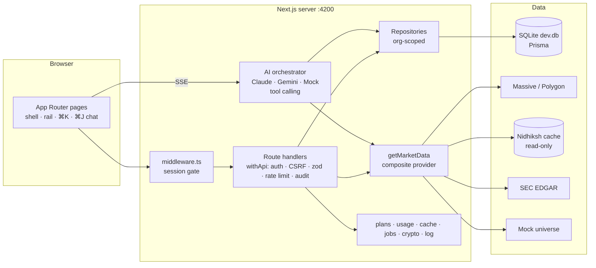

# Nidhiksh Pulse (formerly NidhikshDesk)

> Formerly **AlphaDesk**. Some identifiers keep the old name (`ALPHADESK_FORCE_MOCK`, the `alphadesk/` folder).

NidhikshDesk is a Bloomberg-inspired **research and decision workspace** for hedge fund PMs and equity analysts.
It brings company deep dives, AI research with citations, a screener, portfolio and basket analytics, and team sharing
into one keyboard-driven, dark-first terminal.

**Phase One is research only.** There is no trading, order routing, broker integration or execution, and nothing in
the app is investment advice. Every number carries a source, and every screen that shows simulated data is labelled
**Mock**.

The local demo runs with **no external dependencies**: SQLite, a deterministic 50-stock mock universe and a mock AI
provider. Real data and real AI switch on when you add keys.

- Product brief: [`docs/PRODUCT_SPEC.md`](docs/PRODUCT_SPEC.md)
- Architecture: [`docs/ARCHITECTURE.md`](docs/ARCHITECTURE.md)
- Roadmap: [`docs/ROADMAP.md`](docs/ROADMAP.md)
- Rules for contributors and agents: [`docs/BUILD_CONTRACT.md`](docs/BUILD_CONTRACT.md)
- **Deploying to production (Vercel + Supabase/Neon), env vars, data import, rollback: [`docs/DEPLOY.md`](docs/DEPLOY.md)**

---

## Quick start

Requires Node 20+ (22 recommended) and npm. You don't need Docker.

```bash
cd alphadesk
npm install
cp .env.example .env          # then set NEXTAUTH_SECRET and ENCRYPTION_KEY (see below)
npm run db:push && npm run db:seed
npm run dev                   # http://localhost:4200  (binds 127.0.0.1:4200)
```

Generate the two required secrets:

```bash
openssl rand -base64 32   # NEXTAUTH_SECRET
openssl rand -base64 32   # ENCRYPTION_KEY (must decode to exactly 32 bytes)
```

### Demo logins

Sign-in uses a dev "magic link": enter a seeded email on `/login` and you're signed in. The simulated link is
written to the server console. No email is sent. Demo login is **off in production** (`NODE_ENV=production`)
unless `ALLOW_DEMO_LOGIN=1`; production uses the owner email + password (`PULSE_OWNER_EMAIL` / `PULSE_OWNER_PASSWORD`)
and optional Google sign-in.

| Email | Name | Role | Plan |
|---|---|---|---|
| `pm@nidhikshdesk.dev` | Priya Mehta | ADMIN | **Pro** |
| `analyst@nidhikshdesk.dev` | Alex Chen | ANALYST | **Pro** (stored as `PRO_PLUS`) |
| `intern@nidhikshdesk.dev` | Jordan Lee | VIEWER | **Free** |

All three belong to the seeded org **Demo Capital** (5 seats). The seed also creates watchlists, two portfolios
(*Core Long/Short*, *AI Infrastructure*), a basket, research notes with citations and saved screens.

To get a session cookie for API testing:

```bash
curl -s -H "$(node scripts/dev-login.mjs pm@nidhikshdesk.dev)" http://127.0.0.1:4200/api/me
```

---

## Environment variables

Every provider key is optional. If a key is missing, the app uses local or mock data. Never commit `.env`.

| Variable | Required | Purpose |
|---|---|---|
| `NEXTAUTH_SECRET` | **yes** | Signs the NextAuth JWT session cookie. |
| `NEXTAUTH_URL` | yes | Public base URL, `http://localhost:4200` locally. |
| `DATABASE_URL` | yes | `file:./dev.db` (SQLite, relative to `prisma/`). Phase two: `postgresql://…` |
| `ENCRYPTION_KEY` | **yes** | 32-byte base64 key for AES-256-GCM encryption of user-supplied API keys. |
| `MASSIVE_API_KEY` | no | Massive (formerly Polygon.io) REST key. Tries `api.massive.com` first, then `api.polygon.io`. Sent as a Bearer header, never in a URL. |
| `POLYGON_API_KEY` | no | Legacy alias for `MASSIVE_API_KEY`. `MASSIVE_API_KEY` wins if both are set. |
| `ALPACA_API_KEY` / `ALPACA_SECRET_KEY` | no | Alpaca **market data** (quotes, daily + intraday bars). Data API only (`data.alpaca.markets`); no trading endpoints are called. Sent as `APCA-API-*` headers. |
| `ALPACA_FEED` | no | Bars feed: `sip` (default; request end held 16 min back, as the free plan requires) or `iex`. Quote snapshots always use IEX (the free plan rejects recent SIP snapshots). |
| `ALPACA_ENDPOINT` | no | Trading/paper API base, kept for parity with Nidhiksh Markets. Not used by NidhikshDesk. |
| `ALPHA_VANTAGE_API_KEY` | no | Analyst consensus (`EARNINGS_ESTIMATES`) → Fwd EPS / Fwd P/E and the estimates panel. Free tier is 25 calls/day, 1/s: responses are cached 24h in memory and in `.cache/alphavantage.json` (git-ignored). `OVERVIEW` (ratings, target, ForwardPE) is premium-only and skipped once refused. |
| `SEC_USER_AGENT` | no | Enables live SEC EDGAR (filings, XBRL company facts → financial statements). SEC fair-access policy requires a contact string such as `"NidhikshDesk research you@example.com"`. |
| `NIDHIKSH_DB_PATH` | no | Path to the Nidhiksh Markets local cache (`runtime/market.sqlite`). Opened **read-only**. Skipped if the file doesn't exist. |
| `ALPHADESK_FORCE_MOCK` | no | `1` skips every real provider and serves only the mock universe. Used for demos, tests and CI. |
| `ANTHROPIC_API_KEY` | no | Claude provider for AI research. |
| `ANTHROPIC_MODEL` | no | Default `claude-opus-5-5`. |
| `GEMINI_API_KEY` | no | Gemini provider for AI research. |
| `GEMINI_MODEL` | no | Default `gemini-2.5-pro`. |
| `GOOGLE_CLIENT_ID` / `GOOGLE_CLIENT_SECRET` | no | Turns on Google sign-in. The `/login` button only appears when both are set. New Google users join the first org as VIEWER on Free. |
| `PULSE_OWNER_EMAIL` / `PULSE_OWNER_PASSWORD` | prod: **yes** | Owner sign-in (email + password). First sign-in creates the org and an ADMIN user on Pro. Upgrade requests are emailed to this address. `PULSE_OWNER_NAME` sets the display name. |
| `ALLOW_MOCK_DATA` | no | Mock data fallback. Default **on** in development, **off** when `NODE_ENV=production` unless set to `1`. When off, sections without real data show empty states. |
| `ALLOW_DEMO_LOGIN` | no | `1` enables the email-only demo login in production. Never set this on a public deployment. |
| `TRUST_PROXY` | no | `1` trusts `X-Forwarded-For` for rate limiting (set on Vercel). |
| `FMP_API_KEY` / `FMP_DAILY_LIMIT` | no | Financial Modeling Prep analyst ratings, price targets, analyst actions (daily call budget, default 240). |
| `FRED_API_KEY` | no | FRED macro release dates and Treasury yields. |
| `DIRECT_URL` / `PULSE_DB_SCHEMA` | prod | Direct Postgres URL for schema changes; Postgres schema for Pulse tables (default `pulse`). See [`docs/DEPLOY.md`](docs/DEPLOY.md). |

Users can also save their own Anthropic/Gemini keys in **Settings → AI keys**. These are stored encrypted per user and
take precedence over env keys. If neither is available, the **Mock AI provider** answers with realistic canned
synthesis and citations.

---

## Data provider chain

All market data goes through one server-side entry point, `getMarketData()` in `src/lib/data`. Each call tries the
providers below in order, and the first one that returns non-empty data wins:

1. **Alpaca**: quotes and history (daily, plus `1D` 5-minute and `1W` 30-minute intraday bars) when the Alpaca keys are set.
2. **Massive (Polygon)**: when `MASSIVE_API_KEY`/`POLYGON_API_KEY` is set. Endpoints the plan refuses (403, or 404 on
   `/vX`) are skipped for 6h so they don't use up the 5 calls/min quota.
3. **Nidhiksh local cache**: read-only `better-sqlite3` on `NIDHIKSH_DB_PATH` (daily split-adjusted bars, SEC
   fundamentals, news, filings). It has no intraday bars.
4. **SEC EDGAR**: live filings, and financial statements mapped from XBRL company facts (falls back to the SEC facts in
   the Nidhiksh cache) when `SEC_USER_AGENT` is set.
5. **Alpha Vantage**: consensus estimates when `ALPHA_VANTAGE_API_KEY` is set.
6. **Mock**: a deterministic, seeded 50-stock universe across all 11 GICS sectors. It also synthesises intraday bars. **Only when `mockAllowed()`** (`src/lib/data/mock-policy.ts`): on in development, off in production unless
   `ALLOW_MOCK_DATA=1`. With mock off, missing data is an empty result (not labelled mock) and the UI shows an empty state.

A provider that throws or returns empty data is skipped. The UI never sees an exception. If nothing has data, the
result is `null`/`[]`, marked `isMock: true, provider: 'none'`. Every result has the shape
`{ data, meta: { source[], isMock, asOf, provider } }`.

**Mock labelling:** any screen whose data has `meta.isMock` shows `<MockBanner/>`. On company pages the banner only
considers header data (quote, 1Y history, profile, financials). Sections that are still simulated (for example insiders
or 13F) show their own "Demo" badge instead. The topbar indicator shows the
active mode: *Mock data*, *Mixed: local + mock* or *Live data*. Mock sources have ids like `mock:filing:NVDA:10-K:2025`
and are named "(simulated)".

---

## Plans

Two plans. The paid plan is stored as `PRO_PLUS`; any legacy `PRO` value (the retired $50 tier) is treated as Pro
(`normalizePlan()` in `src/lib/plans.ts`).

| | Free | Pro |
|---|---|---|
| Price | $0 | **$100 / month** |
| Price chart | area / line, 1M–1Y | + candlesticks, 1D / 1W intraday, 5Y / MAX, SMA / EMA / MACD / RSI / crossovers |
| Quote, market cap, P/E (TTM), EPS (TTM) | yes | yes |
| News, filings list, earnings calendar, watchlist, home, market charts + news | yes | yes |
| Analyst research (ratings, price targets, analyst actions, consensus, Fwd EPS / Fwd P/E) | no | yes |
| Financial statements, EV/EBITDA | no | yes |
| Ownership (insiders, 13F) | no | yes |
| Index holdings, sector weights, contribution (`/markets`) | no | yes |
| AI research assistant | no | unlimited |
| Company deep dives | 3 / day | unlimited |
| Portfolio positions | 5 | unlimited |
| Sharing, export, team seats | no | yes (5 seats) |

Gates are enforced **on the server**: `assertFeature` / `checkLimit` in `src/lib/plans.ts` and `requireFeature` in
`src/lib/http.ts`, which returns `403 {error:{code:'upgrade_required'}}`. Premium data is never fetched or serialized
for Free users. They see a locked card built from static sample content, and clicking it opens the upgrade dialog.
The plan is read from the database on every request.

**Billing:** Stripe isn't wired up. "Upgrade to Pro" emails the owner (`PULSE_OWNER_EMAIL`). An ADMIN changes users'
plans in **Settings → Team**. There is no self-serve plan toggle in production.

---

## Architecture overview



See [`docs/ARCHITECTURE.md`](docs/ARCHITECTURE.md) for layers, interfaces and security.

---

## News headlines and calendar

**Headlines** (`src/lib/news`, `GET /api/news?tickers=&sources=&limit=&watchlist=1&only=1`): headline + link + publisher + time + short summary from public, free channels only (no article scraping, no paywall bypass). Official RSS: CNBC, WSJ and MarketWatch (Dow Jones public feeds), NYT, FT, Seeking Alpha, Nasdaq, Benzinga, Investing.com, Yahoo Finance per-ticker. Reuters, Bloomberg, Zacks, Morningstar and general Yahoo Finance have no working public RSS, so they come from Google News RSS searches restricted to the publisher's site (links go through news.google.com). Massive provider news is merged for ticker relevance. Items are de-duplicated by normalised title, sorted newest first and tagged with matching tickers. Each feed times out after 6s and is cached for 5 minutes in memory. The registry with per-source notes is `NEWS_SOURCES` in `src/lib/news/sources.ts`.

**Calendar** (`/calendar`, `GET /api/calendar?from=&to=&types=&scope=watchlist|all`): macro release dates come from the FRED release-dates API (`FRED_API_KEY`, cached 12h). FOMC decisions and minutes (minutes = decision + 21 days) and NYSE holidays are hardcoded from federalreserve.gov and nyse.com in `src/lib/calendar/fomc.ts` and `holidays.ts`, so update them yearly. Earnings come from Alpha Vantage `EARNINGS_CALENDAR` (`ALPHA_VANTAGE_API_KEY`). One call returns three months of data. It is cached for 24h in memory and in `.cache/av-earnings-calendar.json` (gitignored), with a stale-cache fallback. Watchlist names missing from that file fall back to provider catalysts, labelled "Estimated".

## Scripts

| Command | What it does |
|---|---|
| `npm run dev` | Dev server on `127.0.0.1:4200` |
| `npm run build` / `npm start` | Production build, then serve on `127.0.0.1:4200` |
| `npm run typecheck` | `tsc --noEmit` (strict) |
| `npm test` | Vitest unit tests |
| `npm run db:push` | Apply `prisma/schema.prisma` to the database |
| `npm run db:seed` | Reset and seed the demo org, users and content |
| `npm run db:generate` | Regenerate the Prisma client |
| `node scripts/dev-login.mjs <email> [--raw]` | Print a session cookie for curl |
| `node scripts/export-data.mjs` | Export local SQLite workspace data to `data-export/pulse-export-<date>.json` (git-ignored; no sessions, keys or audit logs) |
| `node scripts/import-data.mjs --file … --owner you@x.com [--dry-run] [--add-user email:PLAN:ROLE]` | Idempotent import into the `DATABASE_URL` target (Postgres or SQLite); demo users' content goes to the owner |
| `node scripts/vercel-build.mjs` | Vercel build: Postgres schema in `pulse`, `prisma db push`, `next build` |
| `bash tests/smoke.sh` | Smoke-test pages and APIs on a running server |

## Testing

```bash
npm test                      # unit tests (forces mock data; no network, no DB)
npx tsc --noEmit
bash tests/smoke.sh           # needs `npm run dev` running and a seeded DB
ND_EMAIL=intern@nidhikshdesk.dev bash tests/smoke.sh   # as the Free user
```

The platform critical-path tests live in `src/lib/__tests__/platform-*.test.ts`. They cover:

- session user shape and the middleware protection matrix
- plan gates
- monthly and daily usage reset
- AES-256-GCM round-trip and tamper detection
- CSRF
- the token-bucket rate limiter
- sanitizers
- the composite provider fallback order and mock labelling
- the shortcut registry

Feature tests sit next to each feature under `src/**/__tests__`. `tests/smoke.sh` exits with the number of failed
checks. CI (`.github/workflows/nidhikshdesk-ci.yml` at the repo root) runs typecheck, tests, build and the smoke test
with `ALPHADESK_FORCE_MOCK=1`.

## Keyboard shortcuts

Press `?` anywhere to open the overlay. The registry is in `src/lib/shortcuts.ts`.

| Keys | Action |
|---|---|
| `⌘K` / `Ctrl K` | Search tickers and commands |
| `⌘J` / `Ctrl J` | Toggle AI research chat (every screen) |
| `⌘B` / `Ctrl B` | Collapse or expand the sidebar |
| `?` | Show keyboard shortcuts |
| `Esc` | Close panels and the right rail |
| `G` `D` / `R` / `S` / `P` / `B` / `H` / `,` | Go to Dashboard / Research / Screener / Portfolios / Baskets / Shared / Settings |

Single-key and `G` sequences are ignored while you're typing in an input. `⌘` combos work everywhere.

---

## Running alongside the other Nidhiksh apps

Three local apps can run side by side on this Mac. Each has its own ports and its own database:

| App | Frontend | Backend | Location |
|---|---|---|---|
| Nidhiksh Markets (classic) | 3000 | 8000 | `../frontend`, `../backend` |
| Nidhiksh Pulse | 3100 | 8100 | separate checkout |
| **NidhikshDesk** | **4200** | (same Next.js process) | `alphadesk/` |

NidhikshDesk only **reads** the classic app's market cache (`NIDHIKSH_DB_PATH`), and it opens it with
`readonly: true` and `query_only`. It never writes to it and never calls the other apps' ports. In Docker it also
uses separate ports: Postgres on 5433 and Redis on 6380.

## Docker (phase two)

You don't need Docker for the local demo. `docker-compose.yml` brings up Postgres 16 + pgvector (`db`), Redis
(`redis`) and the app built from the multi-stage `Dockerfile`. The image is built with
`PRISMA_SCHEMA=prisma/postgres/schema.prisma`. An optional `worker` placeholder runs under `--profile worker`.

```bash
docker compose up --build
docker compose exec app npm run db:seed
```

`vercel.json` is set up for a Postgres-backed deploy. SQLite can't run on Vercel's read-only filesystem.

## Known limitations

- **Postgres isn't a drop-in swap yet.** The repos store JSON as strings (`toJson`/`parseJson`) to match the SQLite
  schema. The Postgres schema uses native `Json` columns, so the repos need a small adapter before Docker or Vercel
  deploys will type-check and behave the same. The Docker and Vercel configs are untested here: Docker isn't
  installed on the dev Mac. The YAML and JSON were checked with a parser, and the Postgres schema passes
  `prisma validate`.
- These are all in-memory and single-process: cache, rate limiter, job queue and usage burst control. They don't
  survive a restart and aren't shared across instances. Redis or BullMQ are planned behind the same interfaces.
- You can save a Massive/Polygon key in **Settings → AI keys** (stored encrypted), but the market-data chain
  (`src/lib/data/massive.ts`) currently reads only the env vars. Live data is enabled per deployment, not per user.
- Usage resets on **UTC** month and day boundaries, not the user's local time.
- No real billing (owner upgrades users in Settings → Team), no email delivery (the magic link is simulated) and no real-time streaming
  quotes. Quotes are cached for 30 seconds.
- Mock data is illustrative. Mock financials, news, transcripts and filings are generated and labelled as such.
- AI answers depend on the configured model. Without a key, the Mock provider returns canned synthesis.
- Research only. Nothing in NidhikshDesk is investment advice.
